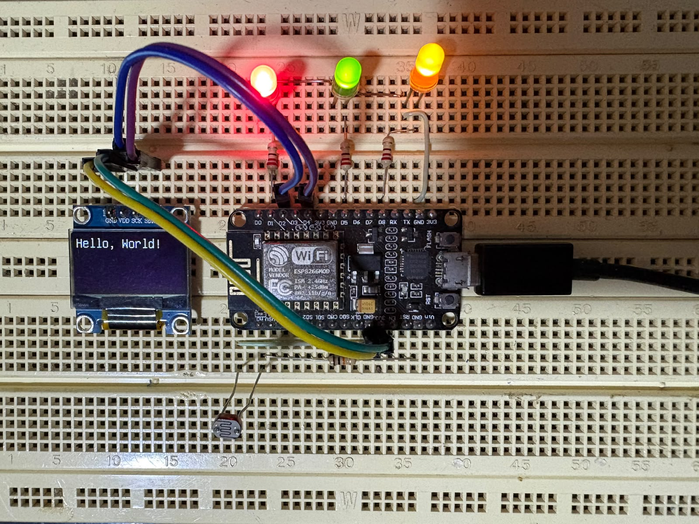
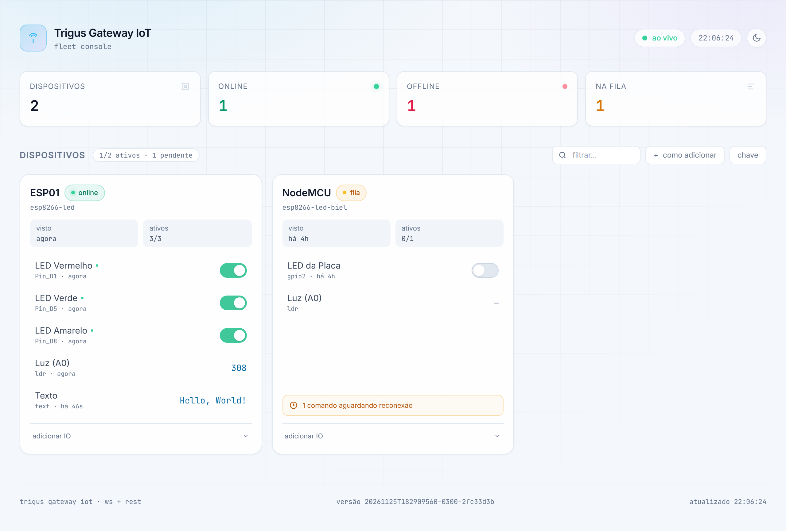

# esp-relay

Controle remoto de IOs (GPIOs) de dispositivos ESP8266/ESP32 **fora da rede local**,
sem abrir porta no roteador do ESP: o dispositivo abre uma conexão WebSocket
persistente para um gateway em Go, que recebe comandos de um painel web (ou de uma API
REST) e os encaminha em tempo real.

O gateway é um **relay reverso**: quem inicia a conexão é o ESP, então nenhum dos dois
lados precisa conhecer o endereço do outro e não há port forwarding. É o mesmo princípio
de tuneis como o `ssh -R` ou o Cloudflare Tunnel, aqui com um protocolo de IOs em cima.

```
┌──────────────┐   WSS /ws?device_id=…   ┌──────────────────────────┐   SSE /events   ┌──────────┐
│  ESP8266     │ ──────────────────────▶ │  Gateway Go (:8080)      │ ──────────────▶ │ Painel   │
│  (firmware)  │ ◀──── sync / set_io ─── │  Hub + data/state.json   │ ◀── REST /api ── │ web (/)  │
└──────────────┘      ack / ping         └──────────────────────────┘                 └──────────┘
```

| Exemplo na placa (`oled-text`) | Painel web |
|---|---|
|  |  |

## O que tem aqui

| Parte | Pasta | Linguagem | Papel |
|---|---|---|---|
| Gateway | [`gateway/`](gateway) | Go 1.22+ | Mantém o estado dos devices, faz a ponte WS, expõe REST/SSE e serve o painel. |
| Lib de dispositivo | [`lib/`](lib) | C++ (PlatformIO) | Protocolo do gateway, transporte WS e dispatcher de comandos. Reutilizável entre placas. |
| Exemplos | [`lib/examples/`](lib/examples) | C++ | `led-blink` (mínimo) e `oled-text` (LEDs, LDR e OLED). |

Uma placa nova reaproveita tudo: declara os IOs nas tabelas por kind
(`kSwitches`/`kNumbers`/`kTexts`) e a lib cuida de `register`, `sync`, `set_io`,
`ack`, ping, Wi-Fi e reconexão. Além de `switch` (bool), um IO pode ser `number` ou
`text`, nos dois sentidos: o firmware **publica** o valor com
`publishNumber`/`publishText` (o painel mostra no lugar do toggle) e **consome** o
valor enviado pelo gateway com `takeText`/`takeNumber` no `loop()` (ex.: OLED,
comando em texto). A lib não lê hardware; quem lê é o projeto. Detalhes em
[`lib/README.md`](lib/README.md).

## Fluxos principais

**Registro de um device novo** — na conexão o firmware envia `register` com os IOs que
suporta; o gateway cria os que faltam (preservando o estado desejado já salvo) e
responde com `sync`. O device aparece sozinho no painel.

**Alternar um IO pelo painel** — o painel faz `POST /api/devices/{id}/io`; o gateway
atualiza o estado desejado, persiste e, se o ESP estiver online, envia `set_io`. Sem `ack`
o estado continua sendo o desejado (o `ack` é confirmação, não requisito).

**ESP offline** — o estado desejado é persistido e o comando entra na `pending_queue`.
Comandos contraditórios do mesmo IO são substituídos para que uma reconexão não aplique
estado obsoleto por último.

O estado inteiro fica em memória (`Hub`) e é persistido de forma atômica em
`data/state.json` (`.tmp` → `Sync` → `Rename`). O painel reflete mudanças em tempo real
via **SSE** e cai para polling de 5 s se o stream não estiver disponível.

## Quickstart

### 1. Gateway

```bash
cd gateway
export IOT_API_KEY="sua-chave-forte"      # obrigatória, o servidor não inicia sem ela
go run .                                   # escuta em :8080
```

Variáveis de ambiente: `IOT_API_KEY` (obrigatória), `LISTEN_ADDR` (padrão `:8080`),
`STATE_FILE` (padrão `data/state.json`). O arquivo de estado é criado no primeiro start.

### 2. Firmware

```bash
cd lib/examples/led-blink
cp src/secrets.example.h src/secrets.h
# edite src/secrets.h: WIFI_SSID, WIFI_PASS, WS_HOST, WS_PORT, DEVICE_ID, API_KEY,
#                      USE_WSS, WS_PATH (e TLS_FINGERPRINT se for validar o cert)

pio run              # compilar
pio run -t upload    # gravar no ESP
pio device monitor   # logs seriais em 115200
```

Para começar na rede local, `WS_HOST` é o IP da máquina do gateway, `WS_PORT 8080` e
`USE_WSS false`. `src/secrets.h` não é versionado — nunca commite credenciais.

### 3. Painel

Abra `http://localhost:8080/` e informe a API Key (ela fica no `localStorage`). Também
é possível abrir com `/#key=<chave>` para configurar de uma vez — o fragmento não vai
para logs do servidor.

## Contratos

Detalhes completos ficam em [`gateway/README.md`](gateway/README.md) e
[`lib/README.md`](lib/README.md). Resumo do comportamento **implementado**:

| Método | Rota | Auth | Descrição |
|---|---|---|---|
| GET | `/` | não | Painel web. |
| GET | `/health` | não | `{"status":"ok"}`. |
| GET | `/events` | sim | Stream SSE do estado (aceita `?api_key=` por limitação do `EventSource`). |
| GET | `/api/devices` | sim | Lista devices, IOs e fila pendente. |
| GET | `/api/devices/{id}` | sim | Detalhe do device (`404` se não existe). |
| PATCH | `/api/devices/{id}` | sim | Renomeia: `{"name":"..."}`. |
| POST | `/api/devices/{id}/io` | sim | Define/cria IO: `{"io":"gpio2","state":true,"name":"LED"}`. |
| DELETE | `/api/devices/{id}/io/{io}` | sim | Remove o IO do console/API (o firmware não muda). |
| GET | `/ws?device_id=<id>` | sim | Socket do dispositivo. |

- Auth: header `X-API-Key`, `Authorization: Bearer <chave>` ou `?api_key=`. Comparação em
  tempo constante.
- `POST .../io` responde `200 OK` quando entregou agora e `202 Accepted` quando
  enfileirou ou falhou ao enviar. Comandos com `delivered:true` **não** entram na fila.
- `DELETE .../io/{io}` remove o IO só do console/API (`404` se não existe). Enquanto o
  firmware anunciar o IO no `register`, ele volta — para apagar de vez, regrave o
  firmware sem ele. Um switch ligado removido recebe `set_io` de volta a `false`.
- Mensagens WS (JSON com `type`): `register`, `sync`, `set_io`, `ack`, `report`,
  `ping`/`pong`. Conexões são encerradas após 90 s sem mensagem; um novo socket
  para o mesmo `device_id` derruba o anterior.
- `report` carrega o valor de IO `number`/`text` (`{"type":"report","io":"ldr",
  "kind":"number","value":734}`). Ele vai ao painel na hora e **não** é gravado no
  `state.json` — só o `kind` do IO persiste.

A coleção de requisições pronta para importar (OpenCollection) fica em
[`docs/api/`](docs/api).

## Testes

```bash
cd gateway
go test ./...

cd ../lib/examples/led-blink
pio test -e native     # protocolo da lib no PC; exige gcc/g++ no PATH
```

No Windows, `pio test -e native` precisa de um compilador de host:
`winget install BrechtSanders.WinLibs.POSIX.UCRT -e`.

Há também um teste de regressão de UI em navegador real (build tag `ui`, Chrome via
CDP) — veja [`gateway/README.md`](gateway/README.md).

O transporte (Wi-Fi, WebSocket, reconexão) não roda no host: ele só se valida em placa
real, contra o gateway.

## Produção

Exponha o gateway atrás de um proxy TLS (Caddy, Nginx, Cloudflare Tunnel) e habilite
`USE_WSS true` no firmware. A API Key nunca deve trafegar em HTTP puro; sem fingerprint
configurado no ESP, o certificado não é validado.

### Atrás de proxy em subpath (ex.: `https://www.exemplo.com/iot/`)

O gateway escuta em `127.0.0.1` e o proxy publica em `/iot/`. São quatro valores no
`secrets.h` — o que mais dói esquecer é o `WS_PATH`:

```cpp
#define WS_HOST "www.exemplo.com"  // domínio, não IP: o certificado depende do host
#define WS_PORT 443                // porta do proxy, não a do gateway
#define USE_WSS true
#define WS_PATH "/iot"             // "" se o gateway estiver na raiz
```

Caddy (dentro do site existente; `handle_path` remove o `/iot` antes do gateway):

```
@iotRoot path /iot
redir @iotRoot /iot/ permanent

handle_path /iot/* {
    reverse_proxy 127.0.0.1:8081 {
        header_up X-Forwarded-Prefix /iot
        flush_interval -1      # SSE sem buffer
    }
}
```

O gateway usa o `X-Forwarded-Prefix` para injetar `<base href="/iot/">` no painel, então
`/api` e `/events` também saem sob `/iot/` (ou defina `BASE_PATH=/iot` no serviço, para
quem chama o gateway sem o header).

Sintoma clássico: `WS_PATH` vazio numa publicação em subpath faz o Upgrade cair no site
vizinho e o ESP logar `WebSocket handshake failed - HTTP 404`.

Para build e publicação do gateway num servidor Windows, veja
[`gateway/README.md`](gateway/README.md#deploy).

## Segurança

- A API Key é uma chave **global** simples: qualquer cliente com ela pode comandar todos
  os devices. Trate o gateway como um painel administrativo, não como um serviço público.
- `/` e `/health` são abertos de propósito (o painel precisa carregar antes de pedir a
  chave). Lockdown extra fica com o proxy.
- O painel usa CDN (Tailwind e Google Fonts): ele precisa de internet para o CSS.

## Licença

[MIT](LICENSE).
